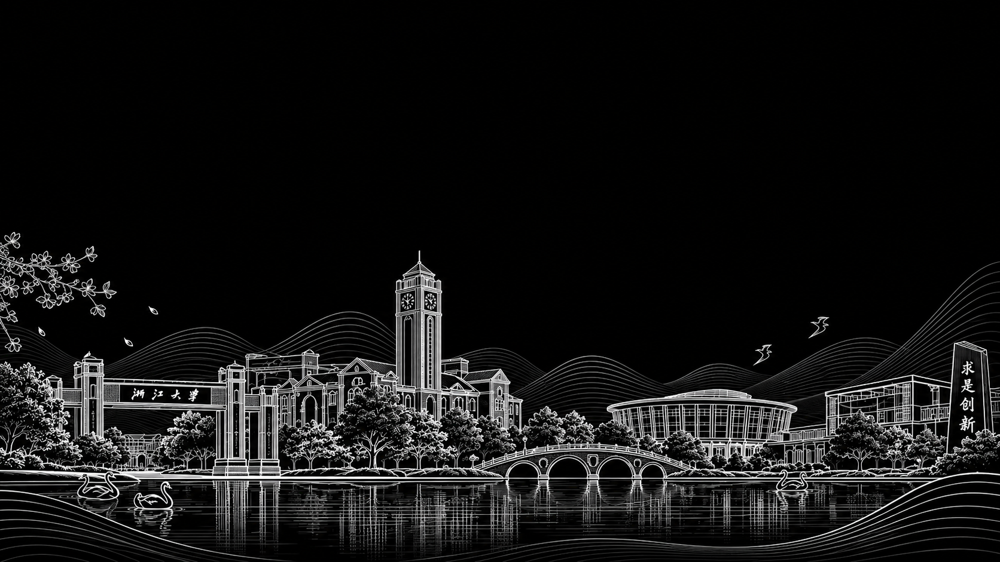
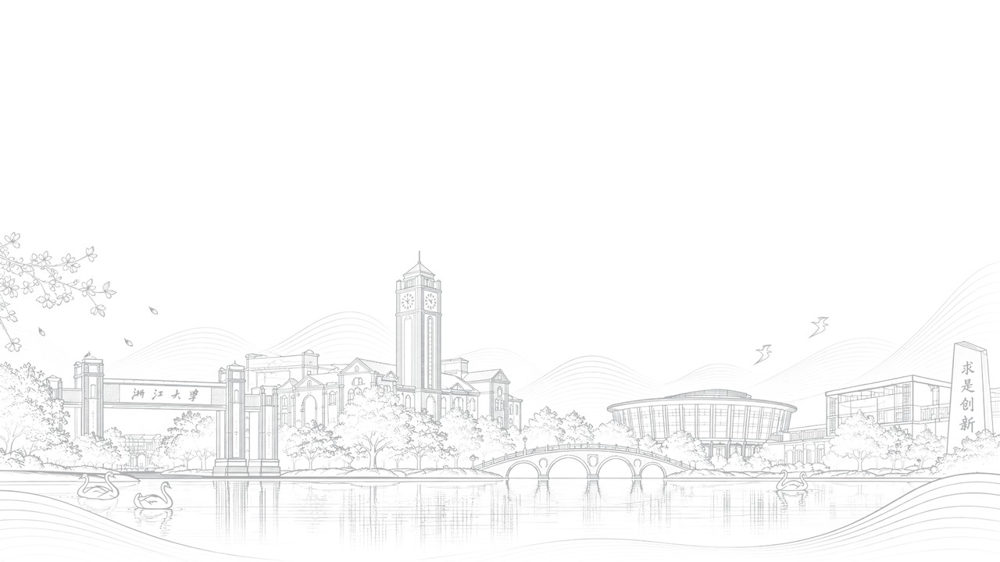
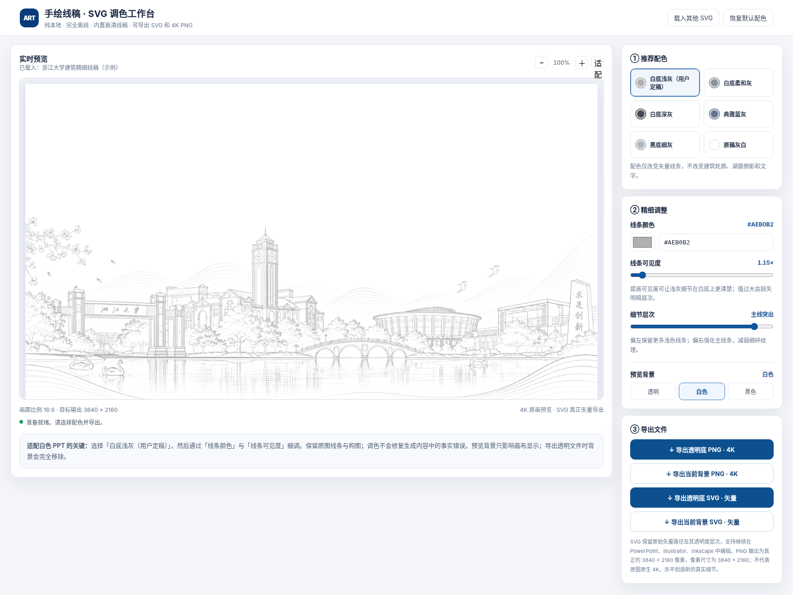

# Architectural Line Art Skillkit


[简体中文](README.zh-CN.md) · [Agent Skills specification](https://agentskills.io/specification)


**From referenced buildings and a hand-drawn image to transparent 4K PNG, genuine multi-layer SVG paths, and a single-file offline color workbench.**


## v0.5 Architecture-first landmark scroll

When a school/city commemorative illustration must show **an entire visual scroll of architectural landmarks**, the default mode is now **`commemorative-montage / landmark-scroll`** (6–10 verified real buildings), rather than 2–5 separate landmarks surrounded by trees, shrubs and lake scenery. Planning distributes distinctive rooflines and facades across left/center/right and deliberately keeps scenery negligible (**architecture >85%, ornament <5% as qualitative artistic design targets**). No default forests, bushes, waves or water reflections. The `hero-montage` 2–5 landmark subtype remains for explicitly sparse visual identities.

`compose_v2.py plan --archetype landmark-scroll` creates a real spatial draft; `integrated_edit.py` packages every cutout and verified primary photo into labeled, SHA-bound reference atlases within the image-input budget; `montage_audit.py` now rejects missing landmark identity, scenic dominance and disconnected layout. **A draft or atlas is never a finished illustration.** [Architecture-first scroll protocol](docs/LANDMARK_SCROLL.zh-CN.md). The real-model visual quality has not been benchmarked.

## v0.4.0 — Real commemorative montage, not a sticker gallery


For school anniversaries, city landmarks, tote-bag artwork and campaign visuals, use **`commemorative-montage`**. Multiple landmarks must form **one harmonious illustration**: a dominant anchor, overlapping supporting architecture, common ground/ornamental connections, and consistent engraving style. Mere horizontal placement of independent transparent building cutouts is **gallery-layout**, not a successful commemorative artwork.


| Intent | Mode | Tools |
| --- | --- | --- |
| One real landmark | `single-building` | Photo-grounded source + vision audit |
| Independent multi-building visual catalog | `gallery-layout` | Legacy `compose.py` |
| Anniversary, tote bag, city/school merchandise & hero visuals | **`commemorative-montage`** | **`compose_v2.py plan/draft` → genuine full-scene reference-image edit → `montage_audit.py`** |


The new `compose_v2.py` is a **functional planner and draft generator**, not a pretend image generator; it creates overlapped hierarchy, wave connectors, guide image and a full-redraw brief. The Agent must then **actually feed** the draft, all cutouts, verified primary building photos and style image to a capable image-generation/editing model. The **final integrated PNG**, not merely separate cutouts, is audited twice per building and twice for overall cohesion. Disjoint galleries, invented roofs/towers or unverifiable official text block approval.


[Detailed English workflow](docs/COMMEMORATIVE_MONTAGE.md) · [完整中文流程](docs/COMMEMORATIVE_MONTAGE.zh-CN.md) · [Plan schema](skills/campus-architectural-lineart/references/montage-plan.schema.json)


**Evidence boundary:** This new path has synthetic unit tests, not yet a live factual-architecture benchmark or a real full-scene image-model run. The old ZJU example is still *unverified artistic montage*; code can reject missing evidence, but cannot mathematically prove architecture accuracy. The current tote-bag profile describes a horizontal 16:9 ink illustration, **not print-shop dielines**.


## Case study — Zhejiang University-inspired architectural line art


Here is the **actual example included in this repository**, from the selected AI illustration to an adjustable, presentation-ready grayscale result. The buildings form an **artistic montage, not a verified depiction of the real campus** ([asset and trademark notes](ASSET_NOTICE.md)).


| Source artwork · black background | Final result · gray lines on white |
| :--: | :--: |
|  |  |
| AI-generated artwork, **1672 × 941** | White-slide preview, line color **`#AEB0B2`** and visibility **`1.15×`** |


### The offline color editor, in use





The screenshot shows the **real browser UI**, not a mockup. Adjust HEX color, visibility and detail emphasis, preview on a white/black/transparent background, then export 4K PNG or true SVG paths. The **Main lines emphasized (主线突出)** setting is selected; its exact original slider number was not visible, so the bundled example uses an adjustable approximation (`detail=1.65`).


**Explore the exact demo files:**


| Artifact | Preview / use |
| --- | --- |
| Selected source illustration | [Source PNG](examples/zju/source-ai-illustration.png) |
| White-slide final appearance | [Full preview](examples/zju/final-gray-on-white-preview.jpg) |
| 4K transparent line art | [Transparent PNG](examples/zju/lineart-transparent.png) |
| Real multi-layer vector output | [SVG with 11 path layers](examples/zju/lineart.svg) |
| Full-featured offline editor | [Download `workbench.html`](examples/zju/workbench.html) and open in Edge/Chrome |


**End-to-end flow:** reference checks → AI illustration (creative step) → transparency extraction + 11-level contour vectorization → 3840 × 2160 exports → single-file offline HTML workbench.


## Photo-grounded reference generation (v0.2.0)


**This is the critical stage before PNG → SVG.** The first Skill now includes runnable reference-evidence tools and a *fail-closed* review gate rather than relying only on generic prompting. It cannot magically guarantee real-world geometry; a human must check photographs, rights and generated architecture.


1. **Collect** full-size, identified and legally usable original photos: at least **two genuinely different camera views per landmark**, each >=1.5 MP (short edge >=850px, long edge >=1400px). Choose one `primary_view_id` to anchor the generator's perspective. Official source pages do not automatically confer derivative rights.
2. **Document** each building's visible roof/facade/tower/door geometry as photo-ID-cited constraints; record the unobserved areas and forbidden inventions. Do not synthesize university wordmarks or inscriptions.
3. **Preflight** validates dimensions, source metadata, image duplicates, photo angles and human evidence fields, then builds original-photo boards, feature crops, a source SHA-256 lock and a per-building `generation-brief.md`.
4. **Generate using real image input:** an Agent must actually attach the original photograph pixels + style image to an image-enabled tool **for each building**. Separately rendered transparent cutouts can then be assembled with the deterministic compositor, rather than asking a model to invent a realistic joint skyline.
5. **Audit** compares the artwork with the cited source photographs, with independent **human-reviewed** feature pass/fail/unknown statuses. Missing/failed checks, unknown additions and changed photos/artwork block approval. `convert.py --approval` binds SVG conversion to the exact reviewed PNG hash.


~~~bash
# Start with a deliberately unverified project manifest and fill it with real evidence
python skills/campus-architectural-lineart/scripts/reference_pipeline.py template --output workspace/project.json
python skills/campus-architectural-lineart/scripts/reference_pipeline.py prepare --manifest workspace/project.json --out-dir workspace/grounding


# Actually provide the original photos as image attachments to a supported image tool.
# Human-compare the result; fill review.json honestly from reference images.
python skills/campus-architectural-lineart/scripts/reference_pipeline.py audit --manifest workspace/project.json --evidence-lock workspace/grounding/evidence-lock.json --image workspace/artwork/final.png --review workspace/artwork/review.json --output workspace/artwork/approval.json


# This rejects stale/unreviewed architecture illustrations
python skills/raster-to-layered-svg/scripts/convert.py --input workspace/artwork/final.png --approval workspace/artwork/approval.json --out-dir workspace/dist --size 3840x2160
~~~


Read: [full Chinese protocol](docs/PHOTO_GROUNDING.zh-CN.md), [photo source selection](skills/campus-architectural-lineart/references/photo-sourcing.md), [JSON evidence/review schema](skills/campus-architectural-lineart/references/evidence-schema.md), [review assistant rubric](skills/campus-architectural-lineart/references/assisted-review.md), and [deliberately unverified starter template](skills/campus-architectural-lineart/examples/README.md).


**Important:** The old ZJU example shown above is an **illustrative AI montage**, not a retrospectively certified accurate architectural reconstruction. Source identity, copyright and visual correctness require actual human verification; the CLI tests evidence/review integrity, not truth. Without an image-input capable model, the Skill should stop with a reference packet rather than claim generation was performed.


## v0.3.0: Agent-first visual verification


The first Skill now supports low-touch, evidence-based photo sourcing and two actual image-aware reviewer passes per landmark: one checks the required features and the other actively searches for invented geometry, text, or viewpoint errors. Any unknown, low-confidence or contradictory finding blocks automatic approval and produces a targeted retry brief.


Use [agent_audit.py](skills/campus-architectural-lineart/scripts/agent_audit.py) with a vision-capable OpenAI Responses API model (your own API key), or let an existing multimodal Agent examine the photos and submit structured, per-image-SHA reports. Only after source hashes, per-building generation call records and all visual checks agree can the candidate be labelled **Agent-reviewed** and passed to SVG export. This is neither human certification nor guaranteed architecture-factual correctness.


Learn more: [Agent audit protocol](skills/campus-architectural-lineart/references/agent-audit.md) · [Chinese walkthrough](docs/AUTONOMOUS_REVIEW.zh-CN.md) · [deliberately unapproved example](examples/agent-review/README.md). Source images with ambiguous derivative rights, official marks and high-stakes photo-faithful work still need appropriate human clearance. The earlier Zhejiang University image remains unverified illustrative art.


## Real multi-reference image edit for commemorative montage (v0.4.1)


For school anniversaries, tote-bag prints and city-identity artwork, `compose_v2.py` first produces a **composition draft** with intentional anchor/support overlap. The optional new [`integrated_edit.py`](skills/campus-architectural-lineart/scripts/integrated_edit.py) calls the actual multi-image OpenAI Images Edit API (when the user configures `OPENAI_API_KEY`), submitting the draft, style reference, original building cutouts and photographed primary views as image attachments. It writes the real request ID and file hashes, for the subsequent [`montage_audit.py`](skills/campus-architectural-lineart/scripts/montage_audit.py) review. Without image-model access, the draft is **not** a deliverable. This integration is covered by mock API tests, not by a real-world illustration quality benchmark. [Workflow](docs/COMMEMORATIVE_MONTAGE.md).


## What you get


| Skill | Purpose | Output |
| --- | --- | --- |
| [`campus-architectural-lineart`](skills/campus-architectural-lineart/SKILL.md) | Architectural reference audit + image generation workflow, with explicit factuality checks | Selected artistic source PNG + reference log |
| [`raster-to-layered-svg`](skills/raster-to-layered-svg/SKILL.md) | Bright-on-dark raster → RGBA & 11-tone actual contour paths | 4K transparent/black PNG + `<path>` SVG |
| [`offline-svg-color-workbench`](skills/offline-svg-color-workbench/SKILL.md) | Build fast, network-free recolor/editor with source embedded | Self-contained HTML with 4 export choices |


These are **three individually installable Agent Skills** (`SKILL.md` + optional `scripts/`, `assets/`, `references/`). They follow the open [Agent Skills](https://agentskills.io/specification) directory convention. AI image generation is an external creative step—not pretended to be a deterministic Python script.


## Try the offline workbench immediately


Open [`examples/zju/workbench.html`](examples/zju/workbench.html) in **Edge or Chrome**. It needs no backend, build step or network connection; the original image and SVG are already embedded.


Controls: HEX picker, visibility slider, fine-vs-main-line balance, white/black/transparent preview, zoom and export as SVG paths or 3840×2160 PNG.


> Source is an **AI-generated illustrative montage**, not an official Zhejiang University rendering. The generated buildings/signage were not exhaustively audited against actual architecture; see [asset notice](ASSET_NOTICE.md).


## Run the full pipeline on your own illustration


Requirements: Python 3.10+ and modern Chrome or Edge.


```bash
python -m pip install -r requirements.txt


# Stage 1 (creative): obtain a source image according to
# skills/campus-architectural-lineart/SKILL.md (native resolution, not falsely labeled 4K)


# Stage 2: true contour SVG + 4K RGBA/black PNG
python skills/raster-to-layered-svg/scripts/convert.py \
    --input examples/zju/source-ai-illustration.png \
    --out-dir dist/zju --size 3840x2160 --title 'Campus illustration'


# Stage 3: standalone offline HTML tool
python skills/offline-svg-color-workbench/scripts/build.py \
    --svg dist/zju/lineart.svg --png dist/zju/lineart-transparent.png \
    --output dist/zju/workbench.html \
    --title 'Campus illustration' --filename 'campus-lineart'
```


Open `dist/zju/workbench.html`; choose `#AEB0B2`, `1.15×` and fine-detail preference, then export transparent SVG or 4K PNG.


## Install in an Agent Skills-compatible coding agent


Clone this repo or download the ZIP; copy each required `skills/<skill-name>/` directory into your agent's skills directory (e.g. `$HOME/.agents/skills/`). Each skill contains a self-contained `SKILL.md` and its own necessary code/resources. No prompt-only magic or proprietary model download is required.


Depending on your agent/client, you can also use a skill installer supporting remote repository URLs once this repository has been published:


```bash
npx skills add <YOUR-GITHUB-REPO-URL>
```


## Technical honesty


- SVG consists of **11 cumulative gray-threshold polygon contour layers**, not hand-placed or semantically separated pen strokes. It has editable `<path>` data and no embedded `<image>`.
- PNG is resampled to **3840×2160 output pixels**. The included AI source is **1672×941**, so output resolution is not native 4K detail.
- Recoloring is non-destructive for geometry, but the SVG and PNG alpha formulas are not guaranteed pixel-identical.
- The visual reference/factual audit remains manual. If accurate architectural representation is a hard requirement, use photo-grounded vector drawing with verification rather than freeform generation.
- Offline HTML contains embedded example assets; custom SVG import has basic sanitization but is intended for trusted user files, not adversarial web content.


## Directory structure


```text
skills/
  campus-architectural-lineart/{SKILL.md,references/}
  raster-to-layered-svg/{SKILL.md,scripts/convert.py}
  offline-svg-color-workbench/{SKILL.md,scripts/build.py,assets/,references/}
examples/zju/
  source-ai-illustration.png          # Native selected AI image
  lineart-transparent.png             # 4K RGBA
  lineart.svg                         # Genuine path SVG, ~8.7 MB
  workbench.html                      # Finished offline application
  final-gray-preview-4k.png           # Example adjusted appearance
  final-gray-on-white-preview.jpg     # README preview
.github/workflows/ci.yml
tests/
```


## Test


```bash
python -m unittest discover -s tests -v
node --check skills/offline-svg-color-workbench/assets/editor.js
```


License: MIT for code and skill text. AI demo art, university wordmarks and factual/rights caveats are discussed in [`ASSET_NOTICE.md`](ASSET_NOTICE.md); the demo is not an official university publication.


