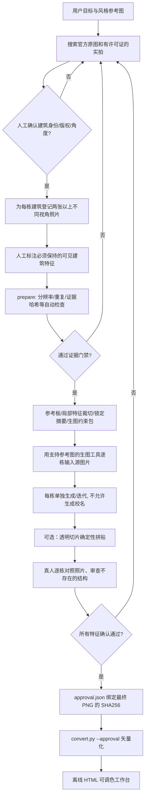

> v0.3 更新：以下保留人工审查流程，适合作为高风险场景的回退方案。低风险创作可使用 [新版 Agent 自动审核与局部修复指南](AUTONOMOUS_REVIEW.zh-CN.md)，不得将 Agent 的证据声明冒充人工确认。

# 从真实建筑照片到可信线稿：新版第一阶段操作指南

## 为什么升级

旧版的第一个 Skill 只有「找照片 → 写提示词 → 生成 → 检查」四句建议，没有要求生图模型实际接收图片，也没有明确建筑事实的核对证据与失败退出方式。最终浙大案例好看，但它是**没有逐栋核验的 AI 艺术拼贴**，不应该被重新包装成“基于真实建筑的精确绘图”。

新版第一阶段加入了可执行的证据/审查门禁（命令行 Python），并推荐每栋建筑先单独生成，再确定性组合以减少不同建筑形态串扰。

## 完整数据流



## 第一步：收集并核验原图

1. 搜建筑全名和校区，优先学校建筑/院系官方来源、原始摄影师或明确许可证的高分辨率图片。
2. 亲自打开**原始摄影页面**核对建筑身份和位置；再打开图片原图记录 URL、摄影师和授权条件，不要只保存搜索结果缩略图。
3. 每栋至少两张 **不同实际拍摄角度** 的原照片，质量至少 1.5MP、短边 >=850px、长边 >=1400px。不能把同一张照片不同裁切假装成两张独立来源。
4. 在照片中定位必须保留的特征，至少屋顶/门窗、拱门/塔楼等两个特征，指定 `primary_view_id`（主相机角度，只能从这一机位绘图）；其他照片仅用于核实建筑细节。记录 `photo_ids` 与可选的归一化裁剪区域：单张照片可用 `bbox`，多视角必须分别写 `bboxes`（绝不能给不同角度复制同一个裁剪框）。
5. 标出未拍到的背面、被遮挡的楼层、无法确认的门洞数量；这些**不允许**让模型根据一般建筑常识补出来。
6. 校徽和校名必须独立核实并作为后期叠加素材，禁止让图像生成模型猜写字体或字符。

运行模板命令：

```bash
python skills/campus-architectural-lineart/scripts/reference_pipeline.py template \
    --output workspace/project.json
```

填完清单后可选运行下载器（仅接收显式指定的原图链接和 allowlist HTTPS 域名；**下载成功不代表许可证/真实性自动核验通过**）：

```bash
python skills/campus-architectural-lineart/scripts/reference_pipeline.py fetch \
    --manifest workspace/project.json \
    --allow-host upload.wikimedia.org \
    --allow-host www.zju.edu.cn
```

如果没有下载权限或者页面有防盗链，让 Agent 或用户保存已经核验的原图至清单指定相对路径。不得编造 URL、来源、摄影师、视角或授权。

## 第二步：将照片转成可供生成模型使用的证据包

```bash
python skills/campus-architectural-lineart/scripts/reference_pipeline.py prepare \
    --manifest workspace/project.json \
    --out-dir workspace/grounding
```

成功后返回：

| 文件 | 作用 |
|---|---|
| `reference-board.png` | 原图排版，标出每张照片的 building/photo ID、视角、分辨率和来源核验人 |
| `feature-crops/...` | 从原始照片裁出屋顶、门洞、塔楼、窗户等人工指定的结构证据 |
| `evidence-lock.json` | 对原始照片和风格图记 SHA-256；引用文件修改时审查自动失效 |
| `generation-brief.md` | 生成模型的输入契约：具体参考图、必须保持、不得发明及不可见结构 |
| `review-template.json` | 审查空表：全部 `unknown`，等待后续真实人工检查 |

如果有缺项，`preflight-report.json` 会显示具体原因，程序退出码为 2；不能随意降低门槛硬过。

## 第三步：真正在**支持图片输入**的模型上进行建筑变换

这里使用生图/图像编辑模型，不是 OpenCV。请把原始照片作为**图片附件**给模型。它需要看到图片中的几何结构：仅把建筑名称或文件路径复制到提示词里无效。

推荐的生成顺序：

1. 每栋建筑单独提交两张以上实拍 + 特征裁切 + 一张风格参考图；写清 `must_match` 与 `forbidden_inventions`。
2. 让模型将**看得见的真实结构**转换为细线建筑插画；选择透明背景输出，禁止新楼、新窗、新钟楼、额外桥梁、校名文字。
3. 对照原图检查，不对就针对特征裁切重新编辑单栋建筑，而不是重画所有建筑。
4. 多栋建筑经人工初验后，用 `compose.py` 按明确坐标组合。不同校区必须明确注明是艺术拼贴，不可称作一个真实机位。
5. 如果建筑必须高度逼真且生图反复变形，应采用基于照片的**人工描画／定向矢量绘图**；提示词不能保证像素结构正确。

本 Skill **不会伪装拥有本地图像生成 API**：只有外部 Agent 环境实际提供可上传原图的图像生成工具时，才能完成这一步。否则只交付经过核验的 `generation-brief.md` 和照片证据包，并提示需要图像工具。

## 第四步：人工逐项核验生成结果

复制 `review-template.json` 到 `workspace/artwork/review.json`，记录实际图像工具及其每栋建筑的照片输入 ID。用户或独立复核者按原始照片检查屋顶、门窗、数量、额外元素、官方文字、构图；每项写 `pass` / `fail` / `unknown`。

注意：将 `pass` 写入 JSON 是**审核人的声明**，CLI 检查声明和证据链完整，并不能通过计算自动证明画面无误。若没有人逐项看过，不允许自动填 `pass`。

```bash
python skills/campus-architectural-lineart/scripts/reference_pipeline.py audit \
    --manifest workspace/project.json \
    --evidence-lock workspace/grounding/evidence-lock.json \
    --image workspace/artwork/final.png \
    --review workspace/artwork/review.json \
    --output workspace/artwork/approval.json
```

通过后 `approval.json` 含最终 PNG 的 SHA-256。修改过任何原图或生成图，须重新审查，不能复用旧批准文件。

## 第五步：矢量化也检查批准文件

```bash
python skills/raster-to-layered-svg/scripts/convert.py \
    --input workspace/artwork/final.png \
    --approval workspace/artwork/approval.json \
    --out-dir workspace/dist --size 3840x2160

python skills/offline-svg-color-workbench/scripts/build.py \
    --svg workspace/dist/lineart.svg \
    --png workspace/dist/lineart-transparent.png \
    --output workspace/dist/workbench.html
```

普通无建筑真实性要求的图片依然可以不用 `--approval`，但**采用第一阶段 photo-grounded Skill 时必须传**。

## 关于浙大旧案例

旧案例来自图像生成工具，能复现 PNG→SVG→HTML，却没有真实建筑逐栋审查所需的完整拍摄照片和模型调用证据。不能把旧图的视觉效果当成新版事实准确性保障的证明。项目 README 仍明确标注其为未经严格核验的艺术拼贴。

## 测试与边界

`python -m unittest discover -s tests -v` 包含使用**合成测试图片**的离线门禁测试：重复图、低清图、缺授权、伪照片来源、没有模型图片附件、人工审查未完成、证据修改、生成图被替换、透明贴图位置等。测试图片不是任何真实大学的建筑照片。

该套件不能自动判断网络图片真伪、版权、摄影视角或模型生成建筑的几何精确性。若缺乏原始证据或合格审查，请返回 `blocked`，绝不声称已事实核验通过。
